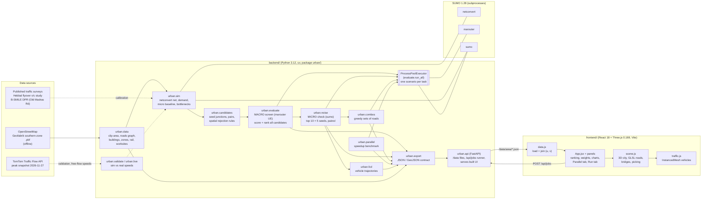

# Parallelized 3D Urban Infrastructure Planning & Traffic Simulation

A semester project that proposes new road links for a real Bengaluru locality and tests each one in a traffic
simulation before anyone builds it. The system:

1. cuts a real road network, buildings and no-build zones out of OpenStreetMap,
2. simulates a calibrated peak hour of traffic and finds the bottlenecks,
3. generates candidate new roads near the bottlenecks and rejects the ones that cannot be built,
4. simulates the network once per candidate, scores each one and ranks them,
5. runs those independent simulations in parallel and measures the speedup (**PAGP**),
6. shows the city, traffic, candidates and before/after results in an interactive 3D interface (**CGVR**).

Study areas: **Hebbal** (Bellary Road × Outer Ring Road flyover junction, metro and suburban-rail works) and
**Baiyappanahalli – Benniganahalli** (Old Madras Road, cut by rail lines and yards). Koramangala is a small test area.

## Documentation

| Document | What it covers |
|---|---|
| [docs/pipeline.md](docs/pipeline.md) | Every pipeline step in order, with its command, input and output |
| [docs/study_guide_backend.md](docs/study_guide_backend.md) | Pipeline step by step, data sources, baseline metrics, the macro screen and the micro check, scoring, results |
| [docs/study_guide_frontend.md](docs/study_guide_frontend.md) | The 3D interface: data loading, scene, shaders, bridges, vehicle animation, panels, interaction |
| [docs/pagp_cgvr_justification.md](docs/pagp_cgvr_justification.md) | Why the parallel computing (PAGP) and graphics (CGVR) components qualify, and what they show |
| [docs/hebbal_study_notes.md](docs/hebbal_study_notes.md) | One-page summary of the final Hebbal numbers for the presentation |
| [idea.md](idea.md) | The original project proposal (source of truth for scope) |
| [frontend/README.md](frontend/README.md) | Frontend run instructions and file list |
| [HANDOVER.md](HANDOVER.md), [CHANGES_2026-11-24.md](CHANGES_2026-11-24.md) | Working notes between team members |

## Architecture



How the pieces talk to each other:

- **Every pipeline step reads and writes plain files** in `backend/data/<area>/` (gitignored). A step can be rerun
  on its own, and long steps checkpoint per scenario, so a killed run resumes where it stopped.
- **SUMO runs as a subprocess** (`netconvert`, `marouter`, `sumo`); results come back as XML files. TraCI is not used.
- **The frontend only reads exported JSON/GeoJSON** (`urban.export`). The schemas are fixed in
  [RESPONSIBILITIES.md](RESPONSIBILITIES.md), so the backend can change without a frontend rewrite.
- **One FastAPI app** serves the exports at the same paths the Vite dev server uses, serves the built UI, and runs
  pipeline steps as background jobs (one at a time, because SUMO steps share route files).

## Repository layout

```text
backend/
  urban/            data, sim, candidates, evaluate, noise, combos, parallel, isolate, validate, live, fcd,
                    export, pick, api  (one module per pipeline step, each runnable with python -m urban.<step>)
  tomtom/           committed TomTom snapshot used for validation
  run_*.ps1         unattended, resumable batch scripts (Windows)
  data/             (gitignored) OSM extract, per-area caches, simulation outputs, exports
frontend/
  src/              App.jsx, data.js, scene.js, traffic.js, colors.js, *Chart.jsx, *Panel.jsx
docs/               study guides and the PAGP / CGVR justification
Dockerfile, docker-compose.yml   one image: built UI + Python + SUMO
```

## Quick start

Prerequisites: Python 3.12 with [uv](https://docs.astral.sh/uv/), Node 18+, SUMO 1.28 (`SUMO_HOME` set), and the
Geofabrik extract `backend/data/osm/southern-zone-latest.osm.pbf` (534 MB; see `backend/urban/data.py`).

```bash
cd backend
uv run python -m urban.data hebbal                     # cut the area out of the OSM extract
uv run python -m urban.sim hebbal                      # network + calibrated micro baseline
uv run python -m urban.candidates hebbal               # candidate roads + feasibility rules
uv run python -m urban.evaluate hebbal --workers 4     # macro screen of every candidate, in parallel
uv run python -m urban.pick hebbal top10               # prints the macro top 10, e.g. 17,16,15,...
uv run python -m urban.noise hebbal --cands <top10> --workers 2   # micro check, 5 seeds each
uv run python -m urban.combos hebbal --pool 10 --max 4 --workers 4 --micro-seeds 5   # optional: sets of roads
uv run python -m urban.parallel hebbal --n 16 --workers 2,4        # optional: speedup benchmark
uv run python -m urban.fcd hebbal --cands <winner>                 # optional: vehicles for the animation
uv run python -m urban.export hebbal                   # write the files the UI reads

cd ../frontend && npm install && npm run dev           # http://localhost:5173  (?area=baiyappanahalli)
```

One app instead of two servers:

```bash
cd frontend && npm run build
cd ../backend && uv run uvicorn urban.api:app --port 8000          # http://localhost:8000
# or, from the repo root:
docker compose up --build
```

Run one SUMO step at a time: every step rewrites the shared demand files in `data/<area>/sim/`. On a 16 GB machine
use at most 4 workers for macro and 2 for micro.

## Headline results

| Area | Winner (micro, 5 seeds, paired) | Notes |
|---|---|---|
| Hebbal | **c11**, 63 m: delay saved **+9.5 ± 4.8 %**, score +8.3, real effect | Macro's top 3 got worse in micro; big shortcuts show Braess-type harm |
| Baiyappanahalli | **c22** (481741594 → 2411848590): **+17.1 ± 7.5 %**, score +29.7, real effect | Baseline is noisy (sd 18 % between seeds) and uncalibrated: relative results only |

Parallel evaluation (Hebbal, 17 macro scenarios, 16-core Windows laptop): speedup 2.00 at 2 workers and 3.62 at
4 workers (efficiency 0.90), with results identical to the sequential run at every worker count.

## Team

| Area | Scope |
|---|---|
| Backend / simulation (PAGP) | Phases 1–5 and the Phase 7 API |
| Frontend / visualization (CGVR) | Phase 6 and the Phase 7 app shell |

See [RESPONSIBILITIES.md](RESPONSIBILITIES.md) for the split and the file contract.
