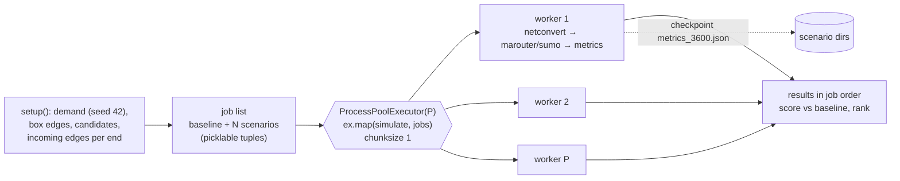

# Justification of the course components: PAGP and CGVR

This document explains why the project's parallel computing part satisfies the **PAGP** component, and why its
3D interface satisfies the **CGVR** component. For each one it covers the requirement in `idea.md`, what was built,
the evidence, and the honest limits.

- [Part A: PAGP (parallel computing)](#part-a-pagp)
- [Part B: CGVR (computer graphics)](#part-b-cgvr)

---

## Part A: PAGP

### A.1 The requirement

`idea.md` §8: candidate scenarios can be evaluated independently against the same baseline demand, so the
evaluation should run in parallel. Show that concurrent evaluation cuts total time **while giving the same results**,
and report execution time, speedup S = Ts / Tp, efficiency E = S / P, throughput, scaling, utilisation, load
balancing and result consistency.

### A.2 Why the problem is genuinely parallel

Evaluating one candidate means: build the network with the new road (`netconvert`), assign or simulate the peak hour
(`marouter` or `sumo`), read the outputs and score them. Each such scenario

- reads only shared, **read-only** inputs: the base network, the demand files, the study-box edge ids, and the
  candidate row with its incoming edge ids (computed once, so workers never load the 30 MB network);
- writes only to **its own directory** (`sim/scenarios/<cand>_<mode>/`);
- has **no communication** with any other scenario until the final ranking.

This is an embarrassingly parallel (task-parallel) workload. The only sequential parts are the setup before the
sweep (demand generation, about 11 s) and the ranking after it (milliseconds). The real workload is far from
trivial: one full-hour run takes about 1.5 minutes (macro) to 20 minutes (micro), and the project runs hundreds of
them (40 macro candidates per area, 10 candidates × 5 seeds in micro, greedy set searches, model-isolation tests).

### A.3 Design



| Decision | Reason |
|---|---|
| **Processes, not threads** (`concurrent.futures.ProcessPoolExecutor`) | The Python side (XML parsing with sumolib, metric sums) holds the GIL; processes run it truly in parallel. A crash or memory blow-up in one scenario cannot corrupt another. |
| **One scenario per task** (chunk size 1) | Run times vary from 21 to 71 s with how much traffic a candidate attracts. A free worker takes the next scenario immediately: **dynamic load balancing** without any scheduler code. |
| **Picklable arguments only** (`simulate(base, routes, box, cand, incoming, out, mode, seed)`) | Workers need no shared memory and no global state; the same function runs sequentially when P = 1. |
| **Explicit seeds per task** | A micro run's result depends only on its arguments, never on which worker ran it or when. |
| **Checkpoint per scenario** (`metrics_<DURATION>.json`) | A killed sweep (power, memory) resumes at the first unfinished scenario. Fault tolerance at task granularity. |
| **One code path** (`evaluate.run_all`) | `urban.evaluate`, `urban.noise`, `urban.combos` and the benchmark all use it, so the benchmark measures the code that produced the results. |

### A.4 How it is measured (`urban.parallel`)

- The same sweep (baseline + N = 16 candidates = 17 macro scenarios, full hour) at P = 1, 2, 4 (and 8 on the Mac).
- Each round starts in a **fresh directory**, so no checkpoint is reused and every round does all the work.
- Per round: wall time Tp, summed per-scenario busy time, **utilisation** = busy / (P · Tp), per-run time.
- **Consistency:** each round's result table (cand, arrived, teleports, mean_time_loss, box_waiting, cand_vph,
  score) is compared with the sequential one using exact equality. Macro is deterministic, so any difference would
  be a bug.
- Output: `data/<area>/parallel.csv` → `parallel.json` → the UI's **Parallel** tab.

### A.5 Results

**Windows laptop (16 cores / 24 threads, 15.7 GB RAM), Hebbal, 17 macro scenarios**

| P | Wall time | Speedup S | Efficiency E | Utilisation | Per-run time | Throughput | Identical |
|---|---|---|---|---|---|---|---|
| 1 | 1,430 s | 1.00 | 1.00 | 1.00 | 84.1 s | 0.71 scen/min | yes |
| 2 | 715 s | **2.00** | **1.00** | 0.99 | 83.7 s | 1.43 scen/min | yes |
| 4 | 395 s | **3.62** | **0.90** | 0.93 | 86.4 s | 2.58 scen/min | yes |

**MacBook (Apple M3, 4 performance + 4 efficiency cores, 8 GB), same sweep**

| P | Wall time | Speedup | Efficiency | Identical |
|---|---|---|---|---|
| 1 | 602 s | 1.00 | 1.00 | yes |
| 2 | 312 s | 1.93 | 0.96 | yes |
| 4 | 188 s | 3.20 | 0.80 | yes |
| 8 | 161 s | 3.75 | 0.47 | yes |

### A.6 Where the efficiency goes

Since Ts ≈ N · r₁ (N scenarios at r₁ seconds each), the efficiency splits exactly into two factors:

```text
E = Ts / (P · Tp) = utilisation × (r₁ / r_P)
```

| Run | Utilisation | r₁ / r_P | Product | Measured E |
|---|---|---|---|---|
| Windows, P = 4 | 0.929 | 84.1 / 86.4 = 0.974 | 0.904 | 0.904 |
| Mac, P = 8 | ~0.87 | 35 / 66 = 0.53 | ~0.46 | 0.47 |

- **Utilisation < 1 = load imbalance.** 17 jobs on 4 workers leave the last wave part-empty, and scenarios vary
  from 21 to 71 s. More scenarios per worker (the full 40-candidate screen) shrinks this tail.
- **r_P > r₁ = resource contention.** Every run reads a 30 MB network and writes MBs of XML; concurrent runs compete
  for memory bandwidth, cache and disk. On Windows this costs 2.7 % at P = 4. On the 8 GB Mac at P = 8 each run took
  almost twice as long, and half of the 8 cores are slower efficiency cores.
- **Amdahl's serial part is negligible here:** the demand generation happens before the timer, and the timed sweep
  contains no serial step except pool start-up and the final ranking. The ceiling is set by memory, not by serial
  code.

A partial run on the larger Baiyappanahalli network shows the same effect more strongly: P = 1 took 1,812 s and
P = 2 took 1,438 s (speedup 1.26), because the per-run time rose from 107 s to 164 s under memory pressure. That
benchmark was not finished or exported, and is quoted only as evidence that memory, not core count, limits scaling.

### A.7 Course concepts demonstrated

| Concept | Where it shows |
|---|---|
| Task (embarrassingly) parallel decomposition | One scenario = one independent task |
| Master–worker / process pool | `ProcessPoolExecutor` in `evaluate.run_all` |
| Dynamic scheduling, load balancing | Chunk size 1; utilisation measured |
| Speedup, efficiency, throughput | `parallel.csv`, Parallel tab |
| Strong scaling (fixed N, growing P) | P = 1, 2, 4 (8) on 17 scenarios |
| Amdahl's law, overheads | §A.6 decomposition |
| Resource contention, heterogeneous cores | Per-run time growth; the M3's mixed cores |
| Determinism, result consistency | Exact equality against the sequential run at every P |
| Fault tolerance | Per-task checkpoints; benchmark rounds resume |
| Portability | Same speedup pattern on Windows x86 and macOS ARM |

### A.8 What was not done, and why

- **GPU / CUDA traffic model** (optional in `idea.md`). SUMO is CPU-only. A CUDA model would have to be a new,
  simplified traffic model, which would break comparability with the calibrated SUMO baseline the results rely on.
  The parallelism the project needs is coarse-grained (whole scenarios), which CPU processes cover well.
- **Distributed execution** across machines. One laptop already runs a full screen in minutes; the file-based design
  (read-only inputs, one output directory per task) would carry over to a cluster without code changes in
  `simulate`.
- **More than 4 workers on Windows** in production runs. With 15.7 GB of RAM shared by the SUMO processes and the
  OS, memory, not cores, is the limit. Micro checks use 2 workers for the same reason.

---

## Part B: CGVR

### B.1 The requirement

`idea.md` §9: a 3D view of the city (roads, intersections, buildings, terrain, obstacles, restricted zones), traffic
(moving vehicles, density, flow, congestion heatmaps, bottlenecks), infrastructure (existing, candidate, selected,
rejected roads, feasibility constraints), scenario comparison (before/after traffic, travel time and congestion
changes) and interaction (camera, zoom, rotation, selecting roads, junctions and candidates, switching scenarios,
inspecting metrics). It must be **the interface through which the user understands and evaluates the output of the
planning system**, not a standalone visualisation.

### B.2 Requirement coverage

| `idea.md` §9 item | Status | How |
|---|---|---|
| Road geometry | done | Ribbons from SUMO edge shapes, width from lane count |
| Intersections | partial | Visible where roads meet; candidate endpoints marked; junctions are not separately selectable |
| Buildings | done | Extruded OSM footprints (heights illustrative) |
| Terrain | not done | Area is nearly flat; listed as a cheap extra (SRTM) |
| Spatial obstacles, restricted zones | done | Water, parks, institutional zones; metro worksite corridors |
| Moving vehicles | done | Real SUMO trajectories, one InstancedMesh |
| Vehicle density, traffic flow | done | GLSL flow dashes at simulated speed; vehicle animation |
| Congestion heatmap, bottlenecks | done | Speed-share colouring per road; road card with delay |
| Existing / candidate / selected / rejected roads | done | Layers for each; candidates coloured by score; rejected pairs layer |
| Feasibility constraints | done | Bridges for grade-separated candidates; crossings, buildings and penalty on the card |
| Before/after network and traffic | done | After and Change views; GPU blend slider; animation baseline vs candidate on one clock |
| Travel-time and congestion changes | done | Per-road delay change (log scale); card shows ΔT, ΔQ and their spread over seeds |
| Camera movement, zoom, rotation | done | OrbitControls with damping; fly-to on selection |
| Select roads / candidates | done | Ray-cast picking with cards and tooltips |
| Scenario switching, metric inspection | done | Macro/micro toggle, weights sliders, before/after, area switcher |

### B.3 Why it is a decision-support interface

The UI answers the planner's questions directly, without reading CSV files:

- **Which roads should I build?** Ranking list and map colours, re-computed live from the user's own weights.
- **Can I trust this result?** The 5-seed mean ± sd and a real-effect / no-effect verdict on every card; a
  Macro | Micro toggle shows that the fast screen's favourites fail the detailed check.
- **What happens on every road if I build it?** Change view and Before ⟷ After slider over the whole network.
- **Why does a big shortcut fail?** The Chart tab shows score falling as traffic on the new road rises (Braess); the
  vehicle animation shows who uses the road.
- **What does it take to build?** Bridges, crossings, demolitions and length on the card and in 3D.
- **Run the pipeline.** The Run tab starts backend steps and shows their logs.

### B.4 Graphics techniques and where they are

| Technique (course topic) | Implementation | File |
|---|---|---|
| Map projection, world coordinates | Local equirectangular projection to metres around the box centre | `scene.js projection` |
| Viewing pipeline | Perspective camera, model-view-projection in custom shaders | `scene.js` |
| Procedural mesh generation | Road ribbons from polylines (offset normals, triangle strips, per-vertex `along` coordinates) | `pushRibbon`, `ribbonGeometry` |
| Polygon triangulation and extrusion | OSM footprints → `Shape` (with holes) → `ExtrudeGeometry` | `polygonShapes`, buildings |
| Sweep surfaces | Bridge deck: closed cross-section swept along a smoothstep-ramped 3D path, level frame (no Frenet twist), flat shading | `bridgePath`, `sweep` |
| Programmable pipeline (GLSL) | Road `ShaderMaterial`: custom attributes (2 colours, 2 speeds, `along`), uniforms (`uTime`, `uMix`, `uFlow`), varyings, procedural moving dashes, fog chunks | `roadMaterial` |
| Shader injection | `onBeforeCompile` adds world-space scrolling stripes to a built-in material; `customProgramCacheKey` | `plannedStripes` |
| GPU interpolation | Before/after as `mix()` in the vertex shader, driven by one uniform | `roadMaterial`, `setMix` |
| Instanced rendering | Vehicles (one InstancedMesh, per-instance matrix and colour); bridge piers | `traffic.js`, bridges |
| Keyframe animation | Linear interpolation of position and speed, shortest-arc heading, quaternion rotation, playback rate | `Traffic.draw` |
| Easing and tweening | Ease-out cubic camera fly-to; exponential easing of `uMix` and of hover lift | `focus`, `_frame` |
| Lighting and shading | Hemisphere + key + fill directional lights; Lambert shading; flat-shaded decks; ACES tone mapping | `CityScene` |
| Depth cues | Linear fog; road layer heights by class; render order for overlays | `CityScene` |
| Picking / ray casting | Screen → NDC → `Raycaster`; face index → road lookup; click vs drag test | `_pick`, `_bindPointer` |
| Hybrid 2D/3D overlays | `CSS2DRenderer` labels with overlap culling | `_label` |
| Visual encoding | Sequential speed scale, diverging score scale, log-scaled diverging delay change | `colors.js` |
| Real-time performance | Merged geometry (one draw call for ~9,000 buildings, one for ~9,500 roads), instancing, attribute-only updates | §13 of the frontend guide |

### B.5 Evidence

- Production build compiles (`npm run build`); rendered in headless Chrome (SwiftShader WebGL) with no shader or
  runtime errors, for the normal view and a selected-candidate view.
- Demo path: Micro check toggle → winner card and bridge → vehicle animation "With candidate" with highlight →
  Before ⟷ After slider → Macro screen (different top 3) → Parallel tab.
- The vehicle animation matches the simulation: 27 users of the new road in 10 minutes ≈ 160 veh/h, against
  188 veh/h in the micro check.

### B.6 Limits, stated honestly

- **Building heights are illustrative** (OSM has none here), and **bridge heights and ramp grades** are not
  engineering designs.
- **No terrain** and **no shadows or post-processing** (bloom, SSAO): listed in `frontend/CGVR_ROADMAP.md`.
- **VR (WebXR) was built and then removed.** A tabletop mode with controller-ray picking worked in an emulator but
  was too fiddly to demo, so the "VR" half of CGVR is covered only as an attempted and documented experiment.
- Vehicles replay a recorded 10-minute window; they are not streamed live from SUMO (TraCI was deferred).
