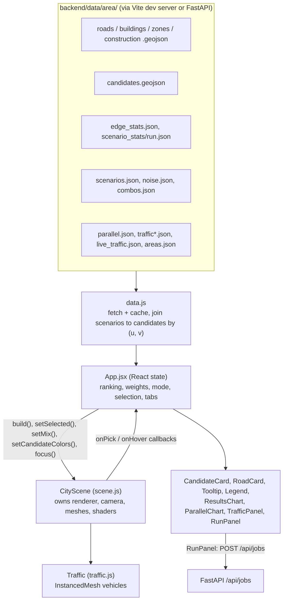

# Frontend study guide

The frontend is the decision-support interface: a 3D model of the study area in which a planner sees where traffic
jams, which new roads the backend proposes, how each one scored, and what changes on every road if it is built.
This guide explains how it is put together, from loading the data to the GLSL shaders. Code lives in
`frontend/src/`.

Contents

1. [Stack and how to run it](#1-stack-and-how-to-run-it)
2. [Architecture](#2-architecture)
3. [Data loading and the file contract (`data.js`)](#3-data-loading-and-the-file-contract-datajs)
4. [Coordinate system and projection](#4-coordinate-system-and-projection)
5. [The scene (`scene.js`)](#5-the-scene-scenejs)
6. [Road shader: congestion colour, flow animation, before/after blend](#6-road-shader-congestion-colour-flow-animation-beforeafter-blend)
7. [Candidates and 3D bridges](#7-candidates-and-3d-bridges)
8. [Animated vehicles (`traffic.js`)](#8-animated-vehicles-trafficjs)
9. [Interaction: picking, hover, camera](#9-interaction-picking-hover-camera)
10. [Panels and the scoring logic (`App.jsx`)](#10-panels-and-the-scoring-logic-appjsx)
11. [Colour scales (`colors.js`)](#11-colour-scales-colorsjs)
12. [Charts, Run tab, deep links](#12-charts-run-tab-deep-links)
13. [Performance choices](#13-performance-choices)
14. [What was tried and removed](#14-what-was-tried-and-removed)
15. [Likely questions](#15-likely-questions)

---

## 1. Stack and how to run it

| Piece | Version | Role |
|---|---|---|
| React | 18.3.1 | Panels, state, user input |
| Three.js | 0.169.0 | WebGL scene: geometry, materials, shaders, picking, camera |
| Vite | 5.4.10 (+ `@vitejs/plugin-react`) | Dev server and production build |

There are no other runtime dependencies. Charts are hand-written SVG, and the OrbitControls, CSS2DRenderer and
BufferGeometryUtils helpers come from `three/examples/jsm`.

```bash
cd backend && uv run python -m urban.export hebbal     # the files the UI reads
cd ../frontend && npm install && npm run dev            # http://localhost:5173
npm run build                                           # frontend/dist, served by the FastAPI app
```

`vite.config.js` adds a small middleware that serves `backend/data/<area>/*.json|geojson` at `/data/<area>/...`,
so no files are copied. The path is checked against a strict regex (no `..`, exported JSON only). `/api` is
proxied to the FastAPI server on port 8000. In production FastAPI serves the same `/data` paths, so the code does
not change between dev and production.

---

## 2. Architecture



The key design rule: **React owns the panels, `CityScene` owns the GPU objects.** React never re-renders the 3D
scene. App calls a few imperative methods on the scene (`build`, `setSelected`, `setHovered`, `setMix`,
`setCandidateColors`, `setLayerVisible`, `focus`, ...), and the scene reports picks and hovers back through
callbacks. This keeps 60 fps rendering independent of React's render cycle and avoids rebuilding thousands of
meshes when a slider moves.

| File | Lines | Role |
|---|---|---|
| `main.jsx` | 5 | Mounts `<App/>` |
| `App.jsx` | ~570 | State, ranking, panels, cards, tooltip |
| `data.js` | ~90 | Loads exports, joins scenario rows to candidate geometry, area switcher |
| `scene.js` | ~730 | Three.js city, shaders, bridges, picking, camera |
| `traffic.js` | ~110 | Vehicle animation |
| `colors.js` | ~35 | Colour scales and legends |
| `ResultsChart.jsx`, `ParallelChart.jsx` | ~55, ~90 | SVG charts |
| `TrafficPanel.jsx`, `RunPanel.jsx` | ~100, ~65 | Animation controls, pipeline job runner |
| `styles.css` | ~260 | Layout and panel styling |

---

## 3. Data loading and the file contract (`data.js`)

- `AREA` comes from `?area=<name>` (default `hebbal`). `areas.json` lists every exported area and its box for the
  area switcher.
- `fetchJSON` caches each request as a promise, so two components asking for the same file share one fetch.
  A failed fetch is evicted from the cache so a retry can succeed.
- `loadAll()` fetches the city layers (required) and the result files (optional: an area with no simulation yet
  still renders its map).
- **Join by `(u, v)`.** Scenario rows (`scenarios.json` macro and micro, `noise.json`) are matched to candidate
  geometry through the candidate's two SUMO junction ids, never through the row index, because indices change
  whenever candidates are regenerated.
- Each selected candidate becomes `{key, feature, props, meso, micro, noise}`: `meso` holds the fast screen's record
  (macro when exported, the older meso screen otherwise; `screen` says which), `micro` the single-seed micro run,
  `noise` the 5-seed summary per candidate variant.
- `loadComparison(cand, sim)` loads `scenario_stats/base_<sim>.json` and `scenario_stats/c<NN>_<sim>.json` for the
  before/after view. Both sides always come from the **same simulator**, because macro and micro baselines differ
  on their own.

---

## 4. Coordinate system and projection

```js
export function projection(bbox) {
  const lon0 = (bbox[0] + bbox[2]) / 2, lat0 = (bbox[1] + bbox[3]) / 2
  const kx = 111320 * Math.cos(lat0 * Math.PI / 180), ky = 110574
  return ([lon, lat]) => [(lon - lon0) * kx, -(lat - lat0) * ky]   // -> [x, z]
}
```

- World axes: x = east (m), y = up (m), z = south (m), origin at the study-box centre.
- This is a **local equirectangular (tangent-plane) projection**: metres per degree of longitude shrink with
  cos(latitude). Over a 2 km box the error against a proper UTM projection is a few centimetres, far below road
  widths.
- Working in metres means lane widths (3.4 m), bridge clearance (6.5 m) and car sizes (4.6 m) are real units.
- `urban.fcd` writes vehicle positions in the same frame, so cars land on the roads without conversion in the browser.

---

## 5. The scene (`scene.js`)

`CityScene` creates the renderer, camera, lights, layers and event handlers once, then `build(data, bbox)` fills the
layers.

**Renderer and camera**

- `WebGLRenderer` with antialiasing, pixel ratio capped at 2, **ACES filmic tone mapping**.
- `PerspectiveCamera` (42° field of view, near 5 m, far 20 km) with `OrbitControls`: damping, polar angle capped
  just above the horizon, zoom 60 m – 6 km.
- Linear **fog** (2.2 – 6 km) fades the padded network into the background so the study box stands out.
- Lighting: a hemisphere light (sky/ground) plus a warm key directional light and a cool fill light.
- A `CSS2DRenderer` overlays HTML labels (road names, hover card anchor) that track 3D positions. Labels closer than
  220 m to one already placed are skipped, since the Hebbal junction has many named ramps.

**Layers.** Each layer is a `THREE.Group` toggled from the Layers panel:

| Layer | Geometry | Material |
|---|---|---|
| Roads | Ribbons built from each edge polyline, width = lanes × 3.4 m; dark casing + coloured strip; arterials drawn slightly higher | Casing `MeshBasicMaterial`; strip custom `ShaderMaterial` (§6) |
| Road names | `CSS2DObject` labels | HTML/CSS |
| Buildings | Every footprint → `Shape` → `ExtrudeGeometry`, all merged into **one mesh** with per-vertex colour | `MeshLambertMaterial` |
| Lakes, parks, no-build zones | Flat shapes coloured by kind (water, park, institutional) | Basic |
| Metro worksites | Wide translucent band + centre line along the construction corridors | Basic, transparent |
| Study box | Ground pad + dashed outline | `LineDashedMaterial` |
| Candidates / bridges | §7 | |
| Feasible-not-selected, rejected pairs | Thin `LineSegments` (off by default) | Basic |
| Real traffic (TomTom) | Sampled segments coloured by current/free-flow ratio | Basic |
| Vehicles | §8 | |

**Ribbons.** `pushRibbon` offsets each polyline point left and right along the local normal to build a triangle
strip. It also stores `along = (distance along the road, lateral 0..1)` per vertex, which the road shader uses for
the dashes. Very short segments are de-duplicated first to avoid degenerate normals.

**Building heights.** OSM has no heights for these areas, so the height is a stable pseudo-random number of floors
(3.2 m each), seeded by the building index and biased by footprint area (mostly 1–3 floors, a few taller blocks).
The guide and the UI both state that heights are illustrative.

**Render loop** (`_frame`): advance `uTime`, ease `uMix` towards its target, update vehicles, update controls and
the camera tween, pulse the selection halos, ease the hovered candidate's lift, render the scene and the labels.
`dt` is capped at 0.1 s so a background tab does not jump the playback.

---

## 6. Road shader: congestion colour, flow animation, before/after blend

The road strip uses a custom `ShaderMaterial` (`roadMaterial`).

**Vertex attributes** (one value per vertex, filled when results load):

| Attribute | Meaning |
|---|---|
| `color` / `color2` | Road colour before / after the selected candidate |
| `speed` / `speed2` | Simulated speed before / after (m/s) |
| `along` | (metres along the road, lateral position 0..1) |

**Uniforms** (shared by all custom materials): `uTime` (seconds), `uMix` (0 = before, 1 = after), `uFlow` (flow
animation on or off), plus Three.js's fog uniforms.

**Vertex shader:** `vColor = mix(color, color2, uMix)` and `vSpeed = mix(speed, speed2, uMix)`. The before/after
switch is therefore a **GPU blend**: moving the Before ⟷ After slider changes one uniform, with no geometry or buffer
rebuild.

**Fragment shader:**

```glsl
float ph = fract((vAlong.x - uTime * vSpeed * 2.5) / 26.0);        // phase moving along the road
float dash = smoothstep(0.0, 0.08, ph) * (1.0 - smoothstep(0.28, 0.4, ph));
float mid = 1.0 - smoothstep(0.18, 0.42, abs(vAlong.y - 0.5));     // only a centre stripe
float moving = smoothstep(0.3, 1.5, vSpeed);                         // no dashes where nothing drives
c = mix(c, c * 1.5 + 0.18, uFlow * dash * mid * moving * 0.55);
```

Light dashes travel along each road in its direction of travel at 2.5× its simulated speed: free-flowing roads
stream, jammed roads crawl, empty roads stay still. Fog and colour-space chunks are included so the custom
material matches the built-in ones.

**Views** (`mode` in App):

| View | `color` | `color2` |
|---|---|---|
| Baseline | Speed as a share of the limit (red jammed → green free) | same |
| After | baseline | the candidate run's speed share |
| Change | Change in each road's total delay: blue = less, red = more (log scale) | |
| Real traffic | TomTom current / free-flow speed on sampled segments | |

---

## 7. Candidates and 3D bridges

**Candidate strips.** Each selected candidate is a ribbon plus a wider transparent glow ribbon and end markers,
coloured by its score under the current weights (`setCandidateColors`). A shader injection gives them a
"planned road" look without writing a whole material:

```js
mat.onBeforeCompile = sh => { /* add vWorldP in the vertex shader; in the fragment shader: */
  // band = fract((x + z) / 7 - uTime * 0.5); darken a stripe of it
}
mat.customProgramCacheKey = () => 'planned-stripes'
```

Diagonal world-space stripes scroll over the built-in `MeshBasicMaterial`, so its colour, opacity and hover
handling keep working. `customProgramCacheKey` stops Three.js from sharing the compiled program with ordinary
materials.

**Bridges.** Candidates with `road_crossings + worksite_crossings > 0` are grade-separated by design, so they are
drawn as raised decks:

1. `bridgePath` samples the straight plan line (48 steps) and lifts it with a **smoothstep ramp**
   h(s) = top · smooth(min(1, s/ramp, (L − s)/ramp)), where top = 6.5 m clearance + 1.3 m deck and the ramp length is
   min(90 m, 0.35 L). Short links get steep ramps, which honestly shows they are hard to build.
2. `sweep` extrudes a closed **cross-section** (deck slab with a parapet on each side) along the path. The section
   is kept level (world up) instead of following Frenet frames, so the deck never twists. Faces are made
   non-indexed and flat-shaded for crisp concrete edges.
3. **Piers** every 24 m are one `InstancedMesh` per bridge: each pier's matrix scales a unit column to the local
   deck height, so all piers of a bridge cost one draw call.

With a candidate selected, only its bridge (and the hovered one) is shown, and the camera flies in low and oblique
so the deck, ramps and piers read as 3D. Heights and grades are illustrative; the score prices crossings through P.

---

## 8. Animated vehicles (`traffic.js`)

Data: `traffic_<run>.json` from `urban.fcd`, i.e. real SUMO vehicles sampled every 2 s for a 10-minute window
(sim time 20–30 min), cut to the box + 150 m. Each frame is a flat array of
`[idx, x, z, angle, kmh, onCandidate, idx, ...]`.

- **One `InstancedMesh`** of box-shaped cars, sized to the largest frame. Every car is one instance, so hundreds to
  thousands of cars cost one draw call.
- **Interpolation.** For each car in frame A, find the same `idx` in frame B through a per-frame `Map`, then lerp
  position, speed and heading. Heading takes the shortest way round (`da -= 360 · round(da/360)`). A car missing
  from B is dropped halfway through the interval (it left the box).
- **Heading.** SUMO angles are degrees clockwise from north, and north is −z here, so the rotation is −angle about +y.
- **Per-instance colour** by speed (`setColorAt`), on the same scale as the roads (0 km/h red → 50 km/h green).
  The material is not tone-mapped, so car colours match the legend.
- **Cars on the candidate** ride on its bridge deck: `lift(x, z)` returns the deck height along the road (SUMO has
  no heights).
- **Highlight** colours every car that uses the new road cyan, 1.6× larger, for its whole trip, with a counter of
  users so far. At Hebbal (old c39) 27 cars used it in 10 min, about 160 veh/h, consistent with the 188 veh/h of the
  micro check.
- **Scale with distance.** Cars grow up to 5× as the camera zooms out, so they stay visible over the whole box.
- **Controls** (`TrafficPanel.jsx`): Off / Baseline / With candidate, play/pause, 1×–30× playback, a time slider.
  Switching run keeps the clock, so before and after line up at the same moment.

---

## 9. Interaction: picking, hover, camera

- **Picking.** On pointer move and click, the pointer is converted to normalized device coordinates and a
  `Raycaster` is cast from the camera. Candidates are tested first (only if their layer is visible), then roads.
  A road hit maps the hit triangle (`faceIndex`) back to its edge through a face-to-road lookup table
  (`triRoad`), giving the edge's properties and stats. The result goes to App through `onPick` / `onHover`.
  Hover picking is throttled to one ray every 60 ms, and a press counts as a click only if the pointer moved less
  than 5 px (otherwise it was a camera drag).
- **Hover.** The hovered candidate eases up a few metres, gets a pulsing outline halo, the others fade back, and its
  bridge deck glows in the score colour. A tooltip shows name, tag, rank, score, delay and queueing change, veh/h,
  and how it is built. Hover is linked: hovering in the list, the chart or the map highlights the same candidate
  everywhere.
- **Selection.** Clicking a candidate opens its card and starts a **camera fly-to**: target and position are lerped
  over 1 s with an ease-out cubic (1 − (1 − k)³). The target is offset so the detail card does not cover the road.
  Bridges get a low oblique view, flat roads a higher top-down one.
- **Camera.** Orbit (rotate), pan and zoom with damping; the polar limit keeps the camera above ground.

---

## 10. Panels and the scoring logic (`App.jsx`)

**Results toggle: Macro screen | Micro check.** It drives the ranking, the scores, the map colours, the chart and
the cards.

- Macro: every screened candidate, ranked by its macro score.
- Micro: only the candidates checked over 5 seeds, ranked by the **5-seed mean score**; the rest are listed below as
  "not checked in micro".

**Live re-scoring.** The score sliders (w1 … w5, defaults equal to the backend's `WEIGHTS`) re-rank everything
instantly:

```js
const scoreOf = (r, w) => Object.keys(SIGN).reduce((s, k) => s + SIGN[k] * w[k] * r[k], 0)
// SIGN: dT +1, dQ +1, dC +1, L −1, P −1
```

Each record carries its components (ΔT, ΔQ, ΔC, L, P), so no simulation is needed to change the weights. For the
micro view the record is the seed average: all terms are linear, so the score of the average equals the average of
the per-seed scores.

**Candidate card:** the 5-seed score (± sd) with its verdict (better / worse / no effect), the macro screen score
for comparison, the score breakdown per term, before/after delay, veh/h on the new road, length, crossings and
buildings. Before / After / Change buttons and the Before ⟷ After slider recolour every road (§6).

**Road card:** a clicked road's name, type, lanes, speed, vehicles and delay; during a comparison, before vs after
for that road.

**Other panels:** tabs (Ranking, Chart, Parallel, Run), the layer toggles, colour legends, the area switcher, and a
real-traffic summary when `live_traffic.json` exists.

---

## 11. Colour scales (`colors.js`)

| Scale | Stops | Used for |
|---|---|---|
| Speed vs limit | 0 red → 0.15 orange-red → 0.4 amber → 0.7 yellow-green → 1 green | Roads, vehicles, TomTom |
| Change in delay | blue (less) → grey (none) → red (more), **log** of \|Δ\| up to 20,000 s | Change view |
| Candidate score | red (≤ −20) → grey (0) → green (≥ +20), clamped | Candidates, chart |
| No traffic | slate grey | Roads with no vehicles |

The delay change uses a log scale because per-road changes span four orders of magnitude; a linear scale would show
only the two or three biggest roads. The score scale is diverging and centred on 0, because the sign is the
decision.

---

## 12. Charts, Run tab, deep links

- **Chart tab** (`ResultsChart.jsx`): score (symmetric log axis) against veh/h on the new road, one dot per
  candidate. It shows the **Braess pattern** at a glance: the more traffic a shortcut attracts, the worse the score.
- **Parallel tab** (`ParallelChart.jsx`): measured speedup against the ideal S = P line, with a table of wall time,
  speedup, efficiency, throughput and a "results identical to sequential" banner. It works even before any
  candidate results exist.
- **Run tab** (`RunPanel.jsx`): pick a pipeline step and arguments, start it through `POST /api/jobs`, watch its
  status and log tail, stop it. One job at a time; run `export` and reload afterwards.
- **Deep links** for demos: `?area=baiyappanahalli`, `?cand=11&view=change&sim=micro`, `?res=macro`, `?tab=parallel`,
  `?view=live`, `?traffic=<run>&t=<seconds>`.

---

## 13. Performance choices

| Choice | Effect |
|---|---|
| All buildings merged into one geometry | ~9,000 extrusions = one draw call |
| All road strips in one mesh (and one casing mesh) | ~9,500 edges = two draw calls; recolouring = rewriting two attribute buffers |
| Before/after as a uniform blend | Slider changes one float; no buffer upload |
| Vehicles as one `InstancedMesh` | One draw call for every car; per-frame cost = matrix and colour writes |
| Piers as one `InstancedMesh` per bridge | One draw call per bridge |
| Three.js scene outside React | Slider and panel updates never re-render the 3D scene |
| Promise cache in `data.js` | Each file fetched once per session |
| Optional result files | An area renders as soon as its map exists |

---

## 14. What was tried and removed

**WebXR (VR) mode.** A tabletop model with controller-ray picking worked in Meta's Immersive Web Emulator, but setup
and aiming were too fiddly for a demo, so it was removed completely. Remaining ideas from `frontend/CGVR_ROADMAP.md`:
shadows and bloom, an FPS/draw-call HUD, building LOD, real building heights.

---

## 15. Likely questions

**Why Three.js and not a game engine or a map library?** The scene is data-driven (GeoJSON in, meshes out), needs
custom shaders and instancing, and must run in a browser next to React panels. Three.js gives direct control of
geometry and GLSL without an engine's build pipeline. A map library would give tiles, not a 3D simulation view.

**Why are heights fake?** OSM has no `height` or `building:levels` for these areas. The heights only give depth; no
result depends on them.

**How does the before/after slider work without lag?** Both states are already on the GPU as vertex attributes;
the slider changes the `uMix` uniform and the vertex shader blends.

**Are the cars real?** Yes: positions come from the SUMO micro run (floating car data), interpolated between 2 s
samples. Only heights on bridges are added.

**Why does the micro view show only ten candidates?** Only the macro top 10 were checked over 5 seeds; ranking the
rest on single runs would be ranking noise.

**Why join on (u, v)?** Candidate indices change each time candidates are regenerated; the junction pair is stable.
